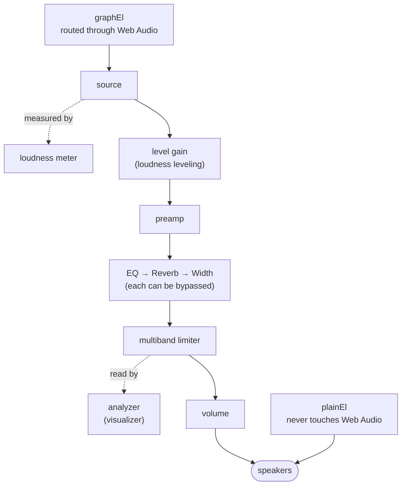

# How it works

For anyone who wants to know how AudioRoom works inside, and why. Several
of the decisions below rest on things that were measured rather than
assumed, and the numbers are kept with them.

- [Two audio elements](#two-audio-elements)
- [The signal chain](#the-signal-chain)
- [Equalizer and limiter](#equalizer-and-limiter)
- [Loudness leveling](#loudness-leveling)
- [Space effects](#space-effects)
- [Local files](#local-files)
- [Now playing](#now-playing)
- [Other notes](#other-notes)

## Two audio elements

An equalizer and a visualizer both need the Web Audio API, and Web Audio may
only process a stream whose server sends an `Access-Control-Allow-Origin`
header. A cross-origin stream without one does not raise an error when routed
through an audio graph. It plays **silence**. Worse,
`createMediaElementSource()` binds an element to the graph *permanently*.

So the engine keeps two audio elements for the life of the window:

- `graphEl` is bound to Web Audio, and carries every station that allows it.
- `plainEl` is **never** passed to Web Audio. A station that can't go through
  the graph still plays on it, with the equalizer and visualizer shown inert
  and the reason given, rather than playing silence.

This comes from the project's start as a browser app, where it mattered: of
250 of the most-played stations in the directory, 42% were served over plain
http, which an https page blocks outright, and some of the rest refused CORS.
The desktop app removes both problems. Its main process adds the CORS header
to every response, so in practice every station that plays gets the full
audio graph. The second element and the probe stay as a safety net, and the
probe still catches dead hosts before playback.

## The signal chain

Each effect is a *stage*, addressed only by its input and output nodes.
Bypassing one means leaving it out of the chain and reconnecting the rest,
without special cases for its wiring. Every link between stages starts at the
preamp or at a stage's output, so disconnecting exactly those leaves each
stage's internal wiring intact.

The visualizer reads the end of the chain, before the volume control. It shows
the station as leveled, equalized and limited, and does not shrink when you
turn the volume down.

## Equalizer and limiter

Bands sit at the ISO octave centers (31 Hz to 16 kHz), Q ≈ 1.414 for one-octave
bandwidth, ±12 dB. Band 0 is a low shelf and band 9 a high shelf, so the
extremes move real energy.

Boosting a band of a track mastered to full scale pushes its peaks over
0 dBFS, and something has to hold them. A full-band limiter does it by
turning the whole mix down, so a boosted kick drum ducks the vocals with it.
Here the signal is split by Linkwitz–Riley crossovers at 150 Hz and 4 kHz,
each band is limited on its own, and the bands are summed into a soft
clipper. A bass hit that would clip pulls down only the bass. The crossovers
sum back to a flat response, so the stage changes nothing audible until it has
to act. The built-in presets lower the preamp so their boosts have room.

## Loudness leveling

Loudness follows ITU-R BS.1770: K-weighting, 400 ms blocks and two-stage gating.

- **Local files** are decoded and measured whole, never by their opening
  seconds. Quiet intros made loud songs get boosted by 12 dB. The next track
  in the queue is measured while the current one plays, so it starts at the
  right level.
- **Streams** are measured on the few seconds the server sends on connect.
  That burst is the same for every listener and was found to be 2–5 dB off a
  30-second reading. It is a starting point only:
  - an unconfirmed reading may boost by at most 6 dB;
  - one 20-second live check then corrects it if it is off by more than 2 LU,
    and after that the level stays put;
  - each station's level is remembered for next time.

## Space effects

The effects rack beside the equalizer adds two effects. Both are in the same
graph, so the same CORS rule applies to them.

- **Reverb**: a `ConvolverNode` fed an impulse response *synthesized at
  runtime* (Room, Club, Hall, Cathedral, Plate). There are no `.wav` assets,
  and room size is a live control. Plain decaying white noise sounds like
  hiss, so each impulse response also gets a one-pole lowpass whose cutoff
  falls across the tail (real rooms absorb treble faster than bass), plus
  discrete early reflections at the front, which is most of what tells the
  ear how big a space is. Dry/wet uses an equal-power crossfade. A linear one
  dips in loudness at the midpoint, because the two signals are uncorrelated
  and sum by power.
- **Stereo width**: a mid-side matrix: `mid = (L+R)/2`, `side = (L-R)/2`,
  `out = mid ± side × width`. Width 1 passes the signal through bit-exact,
  0 is mono, and above 1 is exaggerated. The input is forced to two channels,
  so a mono stream is upmixed instead of landing entirely in the left speaker.

An HRTF `PannerNode` for 3D placement was built and then removed. On radio
material it sounded like a novelty, not something anyone would leave on, and
it only worked properly on headphones.

Measured on the live chain:

- Width 0 gives an L/R correlation of **1.000** (true mono).
- Width 1 gives **0.800**, against the bypassed source's **0.817**: a real
  passthrough.
- Width 1.5 and 2.0 widen it to **0.557** and **0.274**.

All five impulse responses have decorrelated channels (|r| < 0.01), and
every generated tail decays steadily.

## Local files

The renderer cannot load `file://` media, so files are served through a private
`media://` scheme. Its handler answers Range requests, which is what makes
seeking work, and sends permissive CORS headers so files go through the same
audio graph as radio.

Chromium has no decoder for ALAC or WMA, and cannot read AIFF, CAF or ASF
files. Files it cannot play are converted once into a cache, and the handler
serves the converted file at the original URL:

- lossless sources become FLAC, so nothing is lost;
- WMA becomes Opus, at a bitrate above the source's.

The renderer never sees the difference: same URL, same seeking, same audio
graph.

## Now playing

A media element has no way to report the current track, so the player tries
two independent sources and remembers which one worked for each station:

1. **A status endpoint** on the stream's own host: `/status-json.xsl`,
   `/stats?json=1` or `/currentsong?sid=1`. It costs a few kilobytes, and the
   request has no custom header, so no CORS preflight is needed.
2. **ICY metadata inside the stream.** This requires the `Icy-MetaData: 1`
   request header, which is **not** CORS-safelisted. That triggers a
   preflight, which many stream servers never answer: of six stations tested,
   three answered it and three refused. Where it works, the byte stream is
   scanned for `StreamTitle='...'` rather than read at the `icy-metaint`
   offset, because most servers do not expose that header to scripts anyway.

Measured across the starter library:

| station | source | result |
|---|---|---|
| Heart 80s | ICY | artist and title |
| WALM Vinyl HD | status | title |
| Damar Türk FM | status | artist and title |
| Dance Wave! | status | a station slogan, not a track |
| Aardvark Blues FM | none | nothing available |

Roughly half of stations expose a usable track. Aardvark is the instructive
case: `curl` *can* read its ICY metadata, but a browser cannot, because the
server does not answer the preflight.

The cost is bounded:

- The ICY scan gives up after 96 KB. In practice a title turns up within
  15–55 KB.
- The status endpoint costs a few KB.
- Polling runs every 25 s and pauses while the window is hidden.
- A station that returns nothing twice is not polled again.

Some stations put something other than a song in the title field: a slogan,
a tracklist URL or an internal id. Only empty strings and strings with no
letters at all are filtered out. Anything else is shown as broadcast, rather
than guessed at.

HLS stations carry track data as ID3 tags inside the stream instead, which
`hls.js` reports separately. That is not wired up yet.

## Other notes

- `stalled` is not treated as a failure. Chrome fires it whenever no data
  arrives for about 3 s, which is routine while a live stream connects.
  Reloading on it cancels the pending `play()` and kills connections that
  were about to succeed. A 25-second watchdog catches stations that are
  really stuck.
- Plays are reported back to radio-browser.info, so its popularity rankings
  stay useful.
